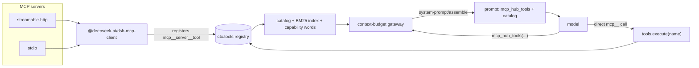

<div align="center">

# dsh-mcp-hub

**The MCP control plane for DeepSeek Harness.**<br>
One resident tool name. Every other schema loads on demand.

[](https://github.com/xunyyds/dsh-mcp-hub/releases/latest)
[](https://github.com/xunyyds/dsh-mcp-hub/stargazers)
[](./LICENSE)
[](#compatibility)
[](#compatibility)
[](#tech-stack)

[English](README.md) | [中文](README.zh.md)

[Why](#why-not-put-every-schema-in-the-prompt) · [Quick start](#quick-start) · [How it works](#how-it-works) · [Gateway reference](#gateway-reference) · [FAQ](#faq)

</div>

---

## Why not put every schema in the prompt?

MCP servers describe their tools with JSON Schema, and those descriptions ride in the request prefix on **every turn**. The numbers are not subtle:

| Workload | Tool schemas in the prompt |
|---|---|
| A 207-tool MCP server | ≈ 770 KB of JSON ≈ 210k tokens |
| Covered by this plugin | one tool name + a catalog measured in server lines |

Most turns use one or two tools. Paying for two hundred schemas to call one is the problem this plugin removes.

`dsh-mcp-hub` keeps **one resident tool name, `mcp_hub_tools`**, plus a compact catalog of server names and tool counts. Tool names and parameter schemas are unfolded in layers, on demand, by the model itself. The execution path is untouched: native `@deepseek-ai/dsh-mcp-client` still connects every enabled server and registers its tools, and the plugin reads that registry. (The panel's connection test is a short-lived JSON-RPC call of its own; it never becomes the execution path.)

The same panel also covers the operational side that usually needs three different files:

- test a server, see latency and tool counts, enable/disable a single tool;
- route MCP approvals through DSH's own approval channel, tool by tool;
- paste an `mcpServers` JSON, a bare URL, a patch fragment, or a `stdio` command;
- adopt servers that DSH already runs, and export the whole setup as one portable JSON.

---

## ✨ Features

| Capability | What you get |
|---|---|
| **Server management** | add / edit / delete, connection tests, latency, tool counts, per-tool toggles |
| **On-demand schemas** | the prompt carries names, not schemas; retrieval cost is independent of the total tool count |
| **Three-tier retrieval** | server list → tool names + summaries → full parameter schema |
| **BM25 search** | Chinese or English keywords, field-weighted ranking, bilingual bridge, typo correction |
| **Reveal and release** | a retrieved tool becomes callable next turn; the model can release tools it no longer needs. No hard cap by default |
| **Auto capability words** | every server line gets feature words computed from tool metadata, not hand-written routing copy |
| **JIT hints** | optional nudge when the current turn contains signals for a server; hard-throttled |
| **Approval** | follows DSH by default, three buttons, per-tool grants, receipts delivered back to the model |
| **Quick import** | parse `mcpServers` JSON, a URL, or a `cordis.patch.yml` fragment into the form |
| **Adoption** | scan existing `mcp-client` entries and bring them under panel management |
| **Backup / restore** | the whole setup as one JSON; merge or replace |
| **Call logs** | per-day record of tool, arguments, approval decision, latency, and outcome |

---

## Quick start

### Requirements

| Item | Requirement |
|---|---|
| DSH | `>= 0.2.1-rc.2` (older runtimes are rejected at load time by `engines.dsh`) |
| Approval channel | `@deepseek-ai/dsh-user-approval`; without it `ask` degrades to a denial (safe default) |
| Node.js | whatever the DSH desktop runtime ships; the plugin is plain ESM with **zero runtime dependencies** |

### 1. Install

```sh
dsh plugin --profile desktop add @dsh-external/dsh-mcp-hub
```

From a local checkout:

```sh
dsh plugin --profile desktop add <path-to-this-repo>
```

### 2. Restart DSH

The **MCP Hub** settings pane appears after a restart. Upgrades work the same way — the panel's *reconnect* only redials MCP servers, it **does not reload plugin code**.

### 3. Add a server

Press *Add* and fill in a URL or a command. Or use **quick import**: paste an `mcpServers` object, a bare URL, a `cordis.patch.yml` fragment, or a `stdio` entry, then press *parse and fill*. Parsing **writes nothing**; saving is still an explicit click, so a bad paste cannot silently overwrite a working server.

### 4. What the model sees

The model gets one resident tool plus a catalog like this:

```text
<mcp-tool-catalog>
所有 MCP 工具的参数 schema 都没有常驻提示词，只用 mcp_hub_tools 一个工具分层展开：
  1) mcp_hub_tools（不带参数）→ 服务器列表
  2) mcp_hub_tools({ server: "<服务器名>" }) → 该服务器的工具名与摘要
  3) mcp_hub_tools({ names: ["<完整工具名>"] }) → 完整参数，之后即可直接调用
也可以用 mcp_hub_tools({ query: "<关键词>" }) 跨服务器检索。
服务器：mobile（33 个工具）：设备·日志·截图·崩溃·安装、rea（7 个工具）：反汇编·符号·函数·二进制·调试
</mcp-tool-catalog>
```

*The injected text is Chinese, shown verbatim; tool names and schemas are unchanged.*

A normal session then looks like this:

```js
mcp_hub_tools({})                                      // server list + per-server counts
mcp_hub_tools({ server: "windows" })                   // names + one-line summaries
mcp_hub_tools({ query: "screenshot" })                 // BM25 hits across servers
mcp_hub_tools({ names: ["mcp__windows__Screenshot"] }) // full schema; tool becomes callable
mcp_hub_tools({ release: ["mcp__windows__Screenshot"] }) // drop it from the callable list
```

### 5. Panel map

| Page | Controls |
|---|---|
| **Servers** | connection test, latency, tool count, per-tool enable/disable, transport, URL/command, token |
| **Approval** | master switch, per-server `inherit` / `follow` / `manual`, current session grants |
| **Gateway & catalog** | retrieval limits, schema byte budget, callable-list cap, catalog switches, byte-exact preview |
| **Local servers** | scan `mcp-client` entries across DSH profiles and adopt one |
| **Backup, import & export** | one JSON for servers, tool policies, approval, gateway, and the loader patch |
| **Call logs** | per-day tool, arguments, approval decision, latency, outcome, raw error |

---

## How it works

### The execution path never moves

`dsh-mcp-hub` is a **registry consumer**, not a second execution client:

- HTTP servers and stdio servers are both connected by native `@deepseek-ai/dsh-mcp-client`;
- the plugin writes its loader entries into its own `cordis.patch.yml`, so DSH starts the same `mcp-client` it would have started anyway;
- tool execution resolves names through `ctx.tools` (`tools.get(name, agent)`), not through the prompt's `tools` array. **Removing a schema from the prompt does not remove the callable tool**; it only changes what the model can see before it asks.

The panel does dial an HTTP server directly for **connection tests and live tool listings** (a `POST` with `initialize` / `tools/list`). That is diagnostics, not execution: no model tool call goes through it, and stdio servers are never spawned by the plugin — their tools come from the registry.

That separation is what makes the whole design safe to uninstall: there is no second connection state to clean up.

### Per-turn path



The gateway hooks `system-prompt/assemble` **after** every other listener has run, and returns a new assembly with the hidden `mcp__*` entries removed. It never mutates another listener's array.

### Three tiers, three costs

| Tier | Call | Returns | Cost |
|---|---|---|---|
| 1 | `mcp_hub_tools()` | server names + per-server tool counts (+ capability words) | O(servers), independent of tool count |
| 2 | `mcp_hub_tools({ server: "windows" })` | that server's tool names + one-line summaries | only this server |
| 3 | `mcp_hub_tools({ names: [...] })` | full JSON Schema for those tools | only those tools |
| — | `mcp_hub_tools({ query: "capture" })` | ranked hits: names + summaries | capped by `searchLimit` |
| — | `mcp_hub_tools({ release: [...] })` | removes tools from the callable list | one line |

A miss never dumps the full tool list. When nothing matches, the reply is a server-level summary pointing at `server=` expansion, so a typo cannot spend the budget that on-demand loading just saved.

### Retrieval is lexical, ranked, and bilingual

`query=` runs BM25 over three fields of every tool:

| Field | Weight | Why |
|---|---|---|
| tool name | 3.0 | the name is the tool's own claim about what it does |
| parameter names | 1.2 | "find the tool that takes `device` / `url`" is a real query path |
| one-line summary | 1.0 | prose is a weaker signal than a name |

`k1 = 1.2`, `b = 0.75`. Document frequency is computed **per request** from the current catalog — a shared cache would go stale whenever a server connects, disconnects, or a tool is toggled, producing the classic "same query worked this morning" bug.

Chinese support is not an afterthought:

- CJK runs are indexed as 2-grams (plus the whole run up to 6 characters), so `反汇编` matches without a dictionary;
- a bidirectional bridge maps `崩溃 ↔ crash`, `反汇编 ↔ disasm`, `截图 ↔ screenshot`, and similar pairs;
- capability words that hit the **tool name** get a ×1.5 boost; a prose mention in a summary does not.

Name typos are repaired, not scolded. `mcp_rea__open_binary` normalizes to exactly one catalog entry and is silently corrected with a note. When several names are close, the reply lists the nearest real ones — the fix for the observed loop of calling the same misspelled name eleven times.

### Reveal and release: the model owns the list

Retrieving a schema marks the tool as **revealed**: on the next assembly it re-enters the callable `tools` array. Without this, a model that strictly respects the `tools` array would loop forever re-fetching a name it can never call.

There is **no hardcoded cap and no LRU eviction**:

- `revealMax` defaults to `0` — unlimited. Every retrieved tool stays callable for the process lifetime.
- The model can deliberately drop tools it no longer needs:

  ```js
  mcp_hub_tools({ release: ["mcp__windows__Screenshot"] })
  mcp_hub_tools({ release: [] })   // list the current callable set
  mcp_hub_tools({ release: ["*"] }) // clear it
  ```

- If a user sets `revealMax > 0`, hitting the cap **does not silently evict the oldest tool**. The reply reports which tools were retrieved but not added, lists the active set, and tells the model to release a slot first. Lowering the cap later never retroactively evicts anything.

The difference matters because auto-eviction is invisible: the model loses a tool it was still using and has no way to know why. An explicit `release` keeps the decision — and the accounting — in the conversation.

### Oversized schemas degrade honestly

`schemaMaxBytes` (default 16 KB) bounds one retrieval. Above it, the schema becomes a shallow view:

1. keep every parameter's name, type, and one-sentence description;
2. drop enums and nested detail;
3. keep **required parameters first**, then binary-search the property count until it fits.

The result is flagged with `parametersTruncated` / `parametersOmitted`, and the schema carries `x-mcp-hub-truncated` explaining that the server still validates the real contract. A tool result never silently pretends to be complete.

### Stable prompt prefix

The catalog and every retrieval result are sorted deterministically (servers by name, hits by score then name). The same configuration must produce byte-identical text on two consecutive assemblies; otherwise the request prefix changes and the provider cache pays for a full re-read. The panel's catalog preview and the injected text come from the same function, so what you inspect is literally what the model receives.

### Smart catalog

Feature words after each server name are **computed from tool metadata**:

```text
Servers: mobile (33 tools): logs·clipboard·click·crash·screenshot, rea (7 tools): function·binary·symbol·disassemble·compare
```

The index is rebuilt only when the tool signature changes, and cached on disk. Words that appear on 80% or more of servers are dropped as non-discriminating; generic terms are computed online instead of living in a blacklist that goes stale on the next server. Each server line costs roughly 15–20 tokens. Above 8 servers the catalog compresses into a grouped summary plus a retrieval hint instead of listing every line. Turn it off on **Gateway & catalog** if you do not want it.

### JIT hints (off by default)

The catalog answers "which servers do I have". JIT hints answer "which one applies *right now*".

When enabled, each turn extracts signals from recent user text plus the last few commands/paths and appends one line when a server's trigger words match:

```text
提示：mobile 有 33 个日志/截图类工具，可用 mcp_hub_tools(query="日志") 查看
```

Signals are deliberately narrow: `adb`, `logcat`, `tombstone`, `anr`, `.so` / `.dex` / `.apk` extensions, `disasm`, `decompile`, `xref`, `il2cpp`, and a small set of Chinese words. Extension-like signals require the dot form, so `also` and `so that` never trigger the `so` signal.

Throttling is hard, because one noisy hint teaches the model to ignore all hints:

- at most 1 per turn;
- at most 1 per server per session;
- at most `hint.maxTotal` per session (default 3);
- the same signal text never produces a second hint;
- saying "can't find a tool / no such tool" lifts the above, while still capping at 1 per turn;
- state is per session; `so` inside `also` / `so that` never triggers.

---

## Gateway reference

The **Gateway & catalog** page tunes `mcp_hub_tools`; saving takes effect on the next request (config is read per execution, no restart):

| Parameter | Default | Range | Effect |
|---|---|---|---|
| `searchLimit` | 8 | 1–20 | max hits per retrieval |
| `catalogLimit` | 200 | 1–500 | tool names listed when a retrieval found nothing usable |
| `schemaMaxBytes` | 16000 | 2000–128000 | byte budget per retrieved schema, above which it degrades |
| `loadBatchMax` | 12 | 1–50 | max tools per `names` call |
| `revealMax` | **0** | 0 = unlimited | callable-list cap; **0 = unlimited**; the model releases tools itself |

Catalog and hint switches:

| Switch | Default | Effect |
|---|---|---|
| `catalog.capabilities` | on | append auto-generated feature words after each server name |
| `catalog.enabled` | on | inject the catalog section at all |
| `catalog.mode` | `names` | `names` = names only; `summary` = names + one-line descriptions |
| `catalog.limit` | 200 | max servers listed in the catalog |
| `hint.enabled` | **off** | master switch for JIT hints |
| `hint.maxTotal` / `hint.maxPerServer` | 3 / 1 | per-session total hint cap / per-server cap |

The on-disk shape (`~/.dsh/storages/mcp-hub/config.json`, or `$DSH_HOME/storages/mcp-hub/config.json`):

```json
{
  "profile": "",
  "approval": { "followDsh": true },
  "gateway": {
    "searchLimit": 8,
    "catalogLimit": 200,
    "schemaMaxBytes": 16000,
    "loadBatchMax": 12,
    "revealMax": 0
  },
  "catalog": { "enabled": true, "mode": "names", "limit": 200, "capabilities": true },
  "hint": { "enabled": false, "maxTotal": 3, "maxPerServer": 1 },
  "servers": []
}
```

These values travel with the plugin backup. Older backups without a field keep local values on **merge** and reset to defaults on **replace**.

### What "tier" means now

Among budget tiers, only `off` disables a server. `full` and `lazy` are equivalent — both mean "unfold on demand"; the `full` name survives only for config compatibility. Server-disabled, tool-disabled, and `off` feed one block reason: gone from the prompt, refused at execution, and unretrievable.

---

## ✅ Approval

The **Approval** page has one master switch and a three-state override per server. The default is **follow DSH**: the same approval panel, the same `ask` / `never` folding, the same official outcome vocabulary. The deployment default policy and current permission preset shown in the panel are read from the official service.

| Button | Effect |
|---|---|
| Reject | this call does not run |
| Allow once | this call only; the next one asks again |
| Allow for this conversation | runs this call and remembers the tool for the rest of the conversation |

"Allow for this conversation" is a single click: the grant is written first, then the call is released. It expires on a new conversation or a DSH restart — grants live on the session, never in config.

Granularity is the **tool**, not the server: approving `send_msg` does not release `get_skey` on the same server. That is deliberate; a server is an administrative unit, not a trust boundary.

**The model is told what happened.** Every approved call ends with a receipt appended to the result body, matching the button that was actually pressed:

```text
[审批：本次已由用户允许一次（下次仍会询问）]
[审批：本次已允许，并记住该工具，本对话内下次不再询问]
```

The first is *Allow once*; the second is *Allow for this conversation*. When a grant already exists and no prompt was shown, the receipt is `[审批：本对话内已授权，本次未再次询问]`.

**Unreadable policy denies.** Without `@deepseek-ai/dsh-user-approval`, or when the official request itself fails, the call fails closed, and both the error text and the DSH log say why. Nothing is silently allowed.

This card takes over approvals for the `mcp__` prefix only; everything else stays with the official panel. It is a runtime-registered slot, so uninstalling restores the original UI — **no DSH core file is modified**.

---

## 📦 Adoption, backup, and logs

The **Local servers** card scans every DSH profile for `mcp-client` entries — profile root and each installed plugin's patch — and lists their sources. *Adopt* copies that configuration into the panel so it can be managed without retyping a URL, a command, or a token. Adoption changes nothing about the connection: it is a record, not a reconnect.

**Backup, import and export** produces one JSON holding the server list, every per-tool policy, the approval master switch, the gateway parameters, and the current loader patch:

```json
{
  "kind": "dsh-mcp-hub/backup",
  "version": 1,
  "exportedAt": "2026-10-20T03:14:15.000Z",
  "profile": "",
  "approval": { "followDsh": true },
  "servers": [ { "name": "qfun", "transport": "streamable-http", "url": "…", "approvalMode": "inherit", "tools": { "send_msg": { "approval": true } } } ],
  "patch": "…"
}
```

- **Merge** keeps existing servers and overwrites matching names; **Replace** clears the list first — use it to reproduce a machine exactly.
- Restores are validated: wrong `kind`, unsupported `version`, and duplicate names are rejected before anything is written.
- An older backup without an `approval` field keeps the local value on merge and falls back to follow mode on replace — "absent" is not "off".
- Call logs are deliberately excluded: they are an append-only daily stream, and folding them in makes the file grow without bound.

⚠️ **A backup carries tokens in plain text. It is a credential file, not a shareable artifact.**

**Call logs** record per day the tool, arguments, approval decision, latency, outcome, and raw error for every call. The `ok` field reflects the **final** outcome, including failures this plugin itself causes.

### HTTP API

The panel is a client of these routes (mounted on DSH's `webServer` under `/mcp-hub`). They are useful for scripts and for understanding what the UI does:

| Route | Methods | Purpose |
|---|---|---|
| `/mcp-hub/status` | GET | aggregate status payload used by the 12 s poll |
| `/mcp-hub/servers` | GET, POST, PUT, DELETE | list / upsert / remove servers, sync loader patch |
| `/mcp-hub/test` | GET `?server=` | dial and report latency, tool count, error |
| `/mcp-hub/reconnect` | POST `?server=` | force a redial without touching config |
| `/mcp-hub/tools` | GET `?server=&fresh=` | tool list from registry or a live dial |
| `/mcp-hub/tool-policy` | POST | per-tool enable / approval policy |
| `/mcp-hub/approval` | GET, POST | approval master switch, per-server mode, session grants |
| `/mcp-hub/budget` | GET, POST | per-server budget tier (`full` / `lazy` / `off`) |
| `/mcp-hub/gateway` | GET, POST | gateway parameters + catalog preview |
| `/mcp-hub/invoke` | POST | invoke one tool from the panel |
| `/mcp-hub/local` | GET, POST | scan / adopt `mcp-client` entries across profiles |
| `/mcp-hub/records` | GET, DELETE | call log stream / clear one day |
| `/mcp-hub/backup` | GET, POST | export / import backup JSON |
| `/mcp-hub/pending` | GET `?callId=` | resolve which MCP tool a pending approval belongs to |

Routes are registered as `GET` handlers and dispatch on `req.method` internally; this is a DSH `webServer` constraint, not an API design choice.

### Security and credentials

- `config.json`, `cordis.patch.yml`, and backup files may contain **plaintext tokens** — never commit or share them. Runtime config lives outside the repo (`storages/mcp-hub`); the config file is written with owner-only permissions (`icacls` on Windows, `0600` elsewhere).
- Stored credentials are returned only to **loopback same-origin** requests: the `Host` header must be a loopback address, `Sec-Fetch-Site` must be `same-origin` / `none`, and any `Origin` must also be loopback. Reaching the panel over a LAN address still manages servers normally, but no tokens are exposed and backup/import requests are rejected with `403`.
- The plugin adds no outbound path beyond the MCP endpoints you configure: the only direct requests are the panel's connection test / tool listing (`initialize`, `tools/list`) against an HTTP server's URL. Tool execution always goes through DSH's `mcp-client`.

---

## Compatibility

| Surface | Supported |
|---|---|
| DSH | `>= 0.2.1-rc.2` |
| Transports | `streamable-http`, `stdio` |
| Tool namespace | `mcp__<server>__<tool>` |
| Approval | `@deepseek-ai/dsh-user-approval` (optional but recommended) |
| Client | DSH web GUI settings pane (`platform: web`) |
| Profiles | any DSH profile; local adoption scans all of them |
| Runtime deps | none (peer deps: `@deepseek-ai/cordis`, `react`, `react/jsx-runtime`) |

---

## Tech stack

| Layer | Choice | Notes |
|---|---|---|
| Language | JavaScript, ESM | no build step, no transpiler |
| Plugin runtime | `@deepseek-ai/cordis` ^4 | service injection, disposers, hooks |
| DSH APIs | `webServer`, `tools`, `systemPrompt` | routes, registry, prompt sections |
| Prompt hook | `system-prompt/assemble` | waterfall; runs last and returns a new assembly |
| Client | React 18 via injected client bundle | no separate app server |
| Persistence | JSON in `storages/mcp-hub` | owner-only permissions |
| Search | in-house BM25 | per-request document frequency, CJK 2-grams |
| Dependencies | **0 runtime** | the published package ships source as-is |

### Repository layout

| Path | Role |
|---|---|
| `cordis.patch.yml` | bundle patch: loads the plugin and one `mcp-client` entry per enabled server |
| `lib/index.js` | plugin entry: config, HTTP routes, approval slot, loader-patch sync, tool guards |
| `lib/gateway.js` | `system-prompt/assemble` hook, the `mcp_hub_tools` definition, retrieval/reveal/release |
| `lib/context-budget.js` | tiers, BM25 ranking, tokenizer, CJK bridge, summary extraction |
| `lib/capability-index.js` | auto capability words, signature cache, catalog compression |
| `lib/jit-hint.js` | signal extraction, trigger matching, per-session throttling |
| `lib/client.js` | the React settings pane (servers, approval, gateway, backup, logs) |

---

## Development

There is no bundler: the package ships ESM source as-is. Work directly on `lib/*.js` and verify with:

```sh
node --check lib/index.js
node --check lib/gateway.js
node --check lib/context-budget.js
node --check lib/capability-index.js
node --check lib/jit-hint.js
node --check lib/client.js
```

Install the local checkout, restart DSH, and use the panel. **Plugin code changes do not hot-reload**: `lib/*.js` is executed from the installed package, not watched. The panel's *reconnect* redials MCP servers only.

Config lives outside the package (`storages/mcp-hub/config.json`), so reinstalling or upgrading the plugin does not overwrite servers, tokens, or policies. The only file the plugin rewrites inside its own package is `cordis.patch.yml`, which it regenerates from the panel's server list.

---

## FAQ

**The MCP Hub pane does not appear.**
Restart DSH. The pane is registered on `webServer` at load time; a plugin added while DSH is running cannot appear until the next start. Check the DSH log for `mcp-hub` load errors.

**No MCP tools show up in the prompt.**
Check three things, in order: (1) the server is enabled in the panel and its connection test passes; (2) `cordis.patch.yml` contains an `mcp-client` entry for it; (3) the native `mcp-client` registered `mcp__*` tools in `ctx.tools`. The `/status` payload and the panel's tool count are the same registry view.

**The model keeps calling `mcp_hub_tools` instead of the tool it retrieved.**
It may not respect the `tools` array: for such models, reveal-on-load has no visible effect and retrieval is pure overhead. Models that do respect the array get the tool back on the next assembly. With `revealMax` at its default `0`, nothing evicts it.

**The model retrieved a tool but says it cannot call it.**
If you set `revealMax` below the number of tools the model needs, the overflow reply lists the active set. Ask it to `release` a tool and re-fetch; or raise `revealMax` / set it to `0`.

**A schema came back truncated.**
The tool's real schema is larger than `schemaMaxBytes`. Either raise the budget (up to 128000), or retrieve that one tool alone in a `names` call. Required parameters are always kept first; `x-mcp-hub-truncated` marks the shallow view.

**Search misses a tool I know exists.**
Retrieval is lexical: words in the name/params/summary rank best. Try `server=<name>` to list the server, or use the exact term from the tool name. A purely conceptual query ("the thing that edits files") may miss; this is a known limitation, not a ranking bug.

**Tokens are blank in the panel when accessed from another machine.**
By design. Credential reads require a loopback same-origin request; LAN clients get the structure without secrets, and credentialed exports are refused with `403`.

**Does this replace `mcp-client` or hold a second connection?**
No. Model tool execution always goes through native `mcp-client`; the plugin only reads the registry and edits the prompt assembly. The panel's *test* button is a separate, short-lived JSON-RPC probe against an HTTP server, not an execution channel.

**Does it work with multiple DSH profiles?**
Yes. Server config is per DSH home (`storages/mcp-hub`), while *Local servers* scans every profile for adoptable `mcp-client` entries.

**Why are tool results in Chinese?**
The model-facing catalog and receipts are Chinese-first, matching the primary user base. Tool names, JSON Schema, and arguments are untouched, so this does not affect calling or validation. The UI and this README are bilingual.

---

## ⚠️ Known limitations

- **Approval depends on DSH's approval channel.** With no composed answerer an `ask` degrades to a denial, which is the safe default.
- **Session grants live in memory and die with the process.** That is deliberate: a grant should not cross conversations or restarts.
- **Plugin code changes do not hot-reload.** After an upgrade or editing `lib/*.js` you must restart DSH.
- **Retrieval is lexical, not semantic.** A conceptual query may miss and fall back to the server-level summary.
- **Reveal-on-load only matters to models that respect the `tools` array.** A model tolerant of out-of-list calls sees no difference.
- **Reveal bookkeeping is process-wide, not per conversation.** Tool names stay callable across sessions in the same DSH process — the price of keeping the registry view simple. Use `release` when the list gets noisy.
- **Single-process assumption.** The config file is the source of truth; running two DSH instances against one `DSH_HOME` will race on writes.

---

## License

MIT — see [LICENSE](./LICENSE).

## Contact

**Author**: xunyyds

**Issues**: [github.com/xunyyds/dsh-mcp-hub/issues](https://github.com/xunyyds/dsh-mcp-hub/issues)

## Finally

- Fork it, learn from it (but if you redistribute, keep the credit — or just drop a star ⭐).

---

<div align="center">

**dsh-mcp-hub** — Because Every Schema Should Earn Its Tokens™

</div>
