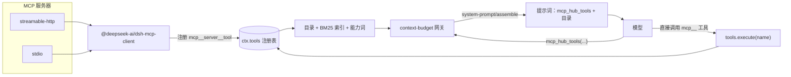

<div align="center">

# dsh-mcp-hub

**DeepSeek Harness 的 MCP 控制台。**<br>
只常驻一个工具名，其余 schema 全部按需展开。

[](https://github.com/xunyyds/dsh-mcp-hub/releases/latest)
[](https://github.com/xunyyds/dsh-mcp-hub/stargazers)
[](./LICENSE)
[](#兼容性)
[](#兼容性)
[](#技术栈)

[English](README.md) | 中文

[为什么](#为什么不把-schema-全塞进提示词) · [快速开始](#快速开始) · [工作原理](#工作原理) · [网关参数](#网关参数) · [常见问题](#常见问题)

</div>

---

## 为什么不把 schema 全塞进提示词？

MCP 服务器用 JSON Schema 描述自己的工具，而这些描述会跟着请求前缀出现在**每一轮**对话里。这笔账很直白：

| 场景 | 提示词里的工具 schema |
|---|---|
| 一台 207 个工具的 MCP 服务器 | ≈ 77 万字节 JSON ≈ 21 万 token |
| 装了这个插件之后 | 一个工具名 + 一份按「行」计价的服务器目录 |

绝大多数轮次只会用到一两个工具。为了这一次调用，先付两百份 schema 的钱——这就是本插件要拿掉的东西。

`dsh-mcp-hub` 只让 **`mcp_hub_tools` 一个工具名常驻**，外加一段只列服务器名与工具数的目录。工具名与参数 schema 由模型自己分层展开、按需取回。执行路径完全没变：`@deepseek-ai/dsh-mcp-client` 仍然是所有服务器的连接方，本插件只读 `ctx.tools` 注册表。（面板的「测试连接」会自己发一次短命的 JSON-RPC；那是诊断，不是执行通路。）

同一个面板还顺手接掉了平时要改三个文件才能做的事：

- 测试服务器、看延迟与工具数、单独启用/禁用某个工具；
- 把 MCP 审批接进 DSH 自己的审批通道，粒度到工具；
- 粘贴 `mcpServers` JSON、裸 URL、patch 片段或 `stdio` 命令；
- 接管 DSH 已经连着的服务器，并把整份配置导出成一个可迁移的 JSON。

---

## ✨ 功能一览

| 能力 | 你能得到什么 |
|---|---|
| **服务器管理** | 增删改、连接测试、延迟、工具数、逐工具开关 |
| **schema 按需** | 提示词里只有名字，没有 schema；检索成本与工具总数无关 |
| **三层展开** | 服务器列表 → 工具名 + 摘要 → 完整参数 |
| **BM25 检索** | 中英文关键词、字段加权、中英桥接、名字手误纠正 |
| **取回与释放** | 取回过的工具下一轮即可调用；不需要时模型自己 `release`，默认不设上限 |
| **能力特征词** | 每台服务器后面自动挂特征词，从工具元数据算出来，不是手写文案 |
| **JIT 提示** | 可选：本轮出现某台服务器的信号时补一行，带硬节流 |
| **审批** | 默认跟随 DSH、三个按钮、按工具授权、结果回执给模型 |
| **快捷导入** | `mcpServers` JSON、URL、`cordis.patch.yml` 片段直接回填表单 |
| **一键接管** | 扫描已有 `mcp-client` 条目，纳入面板管理 |
| **备份 / 恢复** | 整份配置一个 JSON，合并或覆盖 |
| **调用日志** | 按天记录工具、参数、审批决策、耗时与成败 |

---

## 快速开始

### 环境要求

| 项目 | 要求 |
|---|---|
| DSH | `>= 0.2.1-rc.2`（更低版本会在加载时按 `engines.dsh` 直接拒绝） |
| 审批通道 | `@deepseek-ai/dsh-user-approval`；没有时 `ask` 退化为拒绝（安全默认） |
| Node.js | 跟随 DSH 桌面运行时即可；插件是纯 ESM，**零运行时依赖** |

### 1. 安装

```sh
dsh plugin --profile desktop add @dsh-external/dsh-mcp-hub
```

从本地仓库装：

```sh
dsh plugin --profile desktop add <本仓库路径>
```

### 2. 重启 DSH

装完必须重启，设置页才会出现 **MCP Hub**。升级插件同理——面板里的「重连」只重拨 MCP 服务器，**不会重载插件代码**。

### 3. 添加服务器

点「新增」填 URL 或命令。也可以直接用**快捷导入**：粘贴 `mcpServers` JSON、裸 URL、`cordis.patch.yml` 片段或 `stdio` 条目，点「解析并回填表单」。解析**不写任何文件**，保存仍由你显式点击，粘错了也不会静默覆盖正在用的服务器。

### 4. 模型看到什么

模型拿到的是一段目录，加上一个常驻工具：

```text
<mcp-tool-catalog>
所有 MCP 工具的参数 schema 都没有常驻提示词，只用 mcp_hub_tools 一个工具分层展开：
  1) mcp_hub_tools（不带参数）→ 服务器列表
  2) mcp_hub_tools({ server: "<服务器名>" }) → 该服务器的工具名与摘要
  3) mcp_hub_tools({ names: ["<完整工具名>"] }) → 完整参数，之后即可直接调用
也可以用 mcp_hub_tools({ query: "<关键词>" }) 跨服务器检索。
服务器：mobile（33 个工具）：设备·日志·截图·崩溃·安装、rea（7 个工具）：反汇编·符号·函数·二进制·调试
</mcp-tool-catalog>
```

一次正常对话大致是这样：

```js
mcp_hub_tools({})                                      // 服务器列表 + 每台工具数
mcp_hub_tools({ server: "windows" })                   // 这一台的名称 + 一句话摘要
mcp_hub_tools({ query: "screenshot" })                 // 跨服务器 BM25 检索
mcp_hub_tools({ names: ["mcp__windows__Screenshot"] }) // 完整 schema；随后可直接调用
mcp_hub_tools({ release: ["mcp__windows__Screenshot"] }) // 不再需要时移出可调用列表
```

### 5. 面板地图

| 页面 | 能做什么 |
|---|---|
| **服务器** | 连接测试、延迟、工具数、逐工具开关、传输方式、URL/命令、Token |
| **审批** | 总开关、每服务器 `inherit` / `follow` / `manual`、当前会话授权 |
| **网关与目录** | 检索上限、schema 字节预算、可调用列表上限、目录开关、逐字节预览 |
| **本地服务器** | 扫描各 profile 里的 `mcp-client` 条目并接管 |
| **备份、导入与导出** | 一个 JSON 装下服务器、工具策略、审批、网关参数与加载补丁 |
| **调用日志** | 按天记录工具、参数、审批决策、耗时、结局与错误原文 |

---

## 工作原理

### 执行路径始终不在本插件

`dsh-mcp-hub` 是**注册表消费者**，不是第二个执行客户端：

- HTTP 与 stdio 服务器都由原生 `@deepseek-ai/dsh-mcp-client` 连接；
- 插件把加载条目写进自己的 `cordis.patch.yml`，DSH 启动的还是同一个 `mcp-client`；
- 工具执行按名字走 `ctx.tools`（`tools.get(name, agent)`），与提示词里的 `tools` 数组无关。**把 schema 从提示词摘掉，不会把工具变成不可调用**——它只改变模型开口前能看见什么。

面板会对 HTTP 服务器直接发一次 `initialize` / `tools/list`，用于**连接测试与实时工具列表**。那是诊断，不是执行：模型的任何工具调用都不走这条线，stdio 服务器更是从不被插件拉起——它们的工具只从注册表来。

这层分离也让插件可以安全卸载：没有第二份连接状态需要清理。

### 每轮路径



网关挂在 `system-prompt/assemble` 瀑布钩子上：先 `await next()` 让其他监听器把 assembly 组装完，再返回一个移除隐藏 `mcp__*` 条目的**新对象**，绝不原地修改别人的数组。

### 三层，三笔账

| 层 | 调用 | 返回 | 成本 |
|---|---|---|---|
| 1 | `mcp_hub_tools()` | 服务器名 + 每台工具数（+ 能力词） | O(服务器数)，与工具总数无关 |
| 2 | `mcp_hub_tools({ server: "windows" })` | 该服务器的工具名 + 一句话摘要 | 只付这一台 |
| 3 | `mcp_hub_tools({ names: [...] })` | 这几个工具的完整 JSON Schema | 只付这几个 |
| — | `mcp_hub_tools({ query: "capture" })` | 排序后的命中：名字 + 摘要 | 上限由 `searchLimit` 决定 |
| — | `mcp_hub_tools({ release: [...] })` | 从可调用列表移出指定工具 | 一行 |

检索未命中时**绝不会倒出全量工具名**：只回服务器级摘要，并提示用 `server=` 展开。一次笔误不能把按需加载刚省下的预算又花回去。

### 检索：词面、排序、中英双语

`query=` 对每个工具的三个字段跑 BM25：

| 字段 | 权重 | 为什么 |
|---|---|---|
| 工具名 | 3.0 | 名字是工具自己的自述 |
| 参数名 | 1.2 | 「哪个工具要填 `device` / `url`」是真实存在的找法 |
| 一句话摘要 | 1.0 | 散文比名字弱 |

`k1 = 1.2`，`b = 0.75`。文档频率**每次请求现算**：服务器连上、断开或某个工具被禁用都会改变目录，缓存 idf 等于把上一轮的事实当成这一轮的，最后表现成「同一句话上午能搜到、下午搜不到」。

中文不是补丁：

- 连续汉字切 2-gram（整段最多保留 6 字），所以「反汇编」不需要词典也能命中；
- 中英桥接表双向映射 `崩溃 ↔ crash`、`反汇编 ↔ disasm`、`截图 ↔ screenshot`；
- 命中**工具名**的能力词额外 ×1.5，摘要里顺带一提不算。

名字手误会被纠正而不是被训斥。`mcp_rea__open_binary` 归一化后若唯一匹配目录里的真名，会直接纠正并说明；有多个相近名字时列出最接近的几个——这是「同一个错名字连试 11 次」那类死循环的现场修复。

### 取回即揭示，删不删由模型定

取回 schema 会把工具标记为**已揭示**：下一轮装配时它重新进入可调用的 `tools` 数组。不做这一步，严格遵守 `tools` 数组的模型会永远重复取回一个它永远调不到的名字。

这里**没有写死的上限，也没有 LRU 淘汰**：

- `revealMax` 默认 `0`，即不设上限。取回过的工具在进程存活期间一直可调用。
- 不再需要时，由模型显式移出：

  ```js
  mcp_hub_tools({ release: ["mcp__windows__Screenshot"] })
  mcp_hub_tools({ release: [] })   // 只列当前可调用列表
  mcp_hub_tools({ release: ["*"] }) // 清空
  ```

- 如果用户显式把 `revealMax` 设成大于 0，满了也**不会偷偷踢掉最旧的**。返回体会说明哪些工具已取回但没加入、当前列表里有哪些，让模型先 `release` 再重取。之后把上限调小，同样不会追溯删除任何已有条目。

自动淘汰的问题在于它不可见：模型丢了一个还在用的工具，却不知道原因。显式 `release` 把「删还是留」的决定权和账目都留在对话里。

### 超胖 schema 诚实降级

`schemaMaxBytes`（默认 16 KB）约束单次取回。超过时 schema 会变成浅视图：

1. 保留每个参数的名称、类型与一句话说明；
2. 丢掉枚举与嵌套细节；
3. **必需参数永远排在最前面**，再对属性个数二分收敛到预算以内。

结果会带 `parametersTruncated` / `parametersOmitted` 标记，schema 里还有 `x-mcp-hub-truncated` 说明「服务器仍会按真实契约校验」。工具结果不会假装自己完整。

### 稳定的提示词前缀

目录与每次检索结果都按确定顺序排序（服务器按名字，命中按分数再按名字）。同一份配置连续两轮装配必须产出逐字节相同的文本，否则请求前缀变化，提供方缓存就得整段重读。面板的目录预览与真实注入共用同一个函数——你看到的就是模型收到的。

### 智能目录

服务器名后面那串特征词是**从工具元数据算出来的**：

```text
服务器：mobile（33 个工具）：日志·剪贴板·点击·崩溃·截图、rea（7 个工具）：函数·二进制·符号·反汇编·对比
```

索引只在工具签名变化时重建，并落盘缓存。出现在 80% 以上服务器里的词会被判为没有区分度而丢弃；通用词靠在线统计，不靠一份接一台新服务器就过期的黑名单。每台一行约 15–20 token；超过 8 台服务器时自动压缩成「分组摘要 + 检索指引」，不再逐行列。不需要可以在**网关与目录**里关掉。

### JIT 触发提示（默认关闭）

目录回答「我有哪些服务器」，JIT 提示回答「此刻该想起哪一台」。

打开后，每轮从「最近用户说的话 + 最近几条命令/路径」里抽信号，命中某台服务器的触发词就补一行：

```text
提示：mobile 有 33 个日志/截图类工具，可用 mcp_hub_tools(query="日志") 查看
```

信号刻意收得很窄：`adb`、`logcat`、`tombstone`、`anr`、`.so` / `.dex` / `.apk` 扩展名、`disasm`、`decompile`、`xref`、`il2cpp`，以及少量中文词。扩展名类信号必须带点，所以 `also` / `so that` 里的 `so` 永远不会误触发。

节流写得很硬，因为一条噪音就足以让模型开始忽略所有提示：

- 每轮最多 1 条；
- 每会话每台服务器最多 1 次；
- 每会话总计不超过 `hint.maxTotal`（默认 3）；
- 同一段信号文本不会重复提示；
- 你说「找不到工具 / no such tool」会解除上述限制，但仍保留每轮 1 条；
- 状态按会话隔离；`also` / `so that` 里的 `so` 不触发。

---

## 网关参数

**网关与目录** 页可调 `mcp_hub_tools` 的参数；保存后下一次请求生效（配置按执行现读，无需重启）：

| 参数 | 默认 | 范围 | 作用 |
|---|---|---|---|
| `searchLimit` | 8 | 1–20 | 单次检索最多返回几条命中 |
| `catalogLimit` | 200 | 1–500 | 取回全部失败时列出的可用工具名条数 |
| `schemaMaxBytes` | 16000 | 2000–128000 | 单个 schema 取回的字节预算，超了自动降级 |
| `loadBatchMax` | 12 | 1–50 | 一次 `names` 最多取回几个工具 |
| `revealMax` | **0** | 0 = 不限 | 可调用列表上限；**0 = 不设上限**，由模型自己 `release` |

目录与提示开关：

| 开关 | 默认 | 作用 |
|---|---|---|
| `catalog.capabilities` | 开 | 是否在服务器名后面挂自动生成的特征词 |
| `catalog.enabled` | 开 | 是否注入目录段落 |
| `catalog.mode` | `names` | `names` 仅名字；`summary` 名字 + 一句话摘要 |
| `catalog.limit` | 200 | 目录最多列几台服务器 |
| `hint.enabled` | **关** | JIT 触发提示总开关 |
| `hint.maxTotal` / `hint.maxPerServer` | 3 / 1 | 每会话总提示上限 / 每台服务器上限 |

磁盘上的配置长这样（`~/.dsh/storages/mcp-hub/config.json`，或 `$DSH_HOME/storages/mcp-hub/config.json`）：

```json
{
  "profile": "",
  "approval": { "followDsh": true },
  "gateway": {
    "searchLimit": 8,
    "catalogLimit": 200,
    "schemaMaxBytes": 16000,
    "loadBatchMax": 12,
    "revealMax": 0
  },
  "catalog": { "enabled": true, "mode": "names", "limit": 200, "capabilities": true },
  "hint": { "enabled": false, "maxTotal": 3, "maxPerServer": 1 },
  "servers": []
}
```

这些值会随整插件备份一起导出/还原；旧备份没有某个字段时，合并保留本机现值、覆盖回到默认值。

### 档位现在怎么理解

在投放档位里，只有 `off` 会关掉一台服务器。`full` 与 `lazy` 现在等价，都是「按需展开」；保留 `full` 这个名字只为兼容旧配置。整台禁用、逐工具禁用、`off` 档位三者共用同一份拦截原因：既从提示词消失，也拒绝执行，还不能被检索取回。

---

## ✅ 审批

**审批** 页有一个总开关，以及每台服务器的三态覆盖。默认是**跟随 DSH**：同一个审批面板、同一套 `ask` / `never` 折叠、同一份官方结果词表。面板上显示的「部署默认策略」与「当前权限预设」也直接读官方服务的值。

| 按钮 | 作用 |
|---|---|
| 拒绝 | 本次调用不执行 |
| 允许一次 | 只放行这次，下次仍会询问 |
| 本对话内允许 | 放行这次并记住该工具，本对话内不再询问 |

「本对话内允许」是一次点击：先写授权、再放行。换对话或重启 DSH 即失效——授权记在会话上，不写进配置。

粒度是**工具**而不是服务器：批准 `send_msg` 不会顺带放行同服务器的 `get_skey`。这是刻意的，服务器是管理单位，不是信任边界。

**审批结果会告诉模型。** 每次审批过的调用，结果正文末尾会带回执，按你实际点的按钮区分：

```text
[审批：本次已由用户允许一次（下次仍会询问）]
[审批：本次已允许，并记住该工具，本对话内下次不再询问]
```

第一条对应「允许一次」，第二条对应「本对话内允许」。本对话内已有授权、这次没再弹窗时，回执是 `[审批：本对话内已授权，本次未再次询问]`。

**读不到策略就拒绝。** 没组合 `@deepseek-ai/dsh-user-approval`、或官方请求自身失败时，按 fail closed 拒绝，并在错误信息与日志里说明原因，不静默放行。

这张卡片只接管 `mcp__` 前缀的审批，其他审批仍走官方面板。它是运行时注册的插槽，卸载插件即恢复原状，**不修改任何 DSH 核心文件**。

---

## 📦 接管、备份与日志

**本地服务器** 卡片会扫描每个 DSH profile 里的 `mcp-client` 条目（含 profile 根目录和各已装插件的补丁），列出它们的来源。点「接管到面板」即可纳管，无需重填 URL、命令或 Token。接管不改变连接，只是把它记进面板。

**备份、导入与导出** 会导出一个 JSON，含服务器列表、逐工具策略、审批总开关、网关参数和当前加载补丁：

```json
{
  "kind": "dsh-mcp-hub/backup",
  "version": 1,
  "exportedAt": "2026-10-20T03:14:15.000Z",
  "profile": "",
  "approval": { "followDsh": true },
  "servers": [ { "name": "qfun", "transport": "streamable-http", "url": "…", "approvalMode": "inherit", "tools": { "send_msg": { "approval": true } } } ],
  "patch": "…"
}
```

- **合并** 保留现有服务器，同名覆盖；**覆盖** 先清空列表，用于精确复刻一台机器。
- 导入前会校验：`kind` 不对、`version` 不支持、服务器重名，都会在写入前被拒。
- 旧备份没有 `approval` 字段时，合并保留本机现值，覆盖则回到「跟随」——「没写」不等于「关掉」。
- 调用日志刻意不放进备份：它是按天追加的流水，塞进去只会让文件无限增长。

⚠️ **备份里的 Token 是明文。它是凭证文件，不是可分享的产物。**

**调用日志** 按天记录每次调用的工具、参数、审批决策、耗时、成败与错误原文。`ok` 字段反映最终结局，包括插件自身造成的失败。

### HTTP API

面板是下面这些路由的客户端（挂在 DSH 的 `webServer` 上，前缀 `/mcp-hub`）。写脚本或排查 UI 行为时可以直接用：

| 路由 | 方法 | 用途 |
|---|---|---|
| `/mcp-hub/status` | GET | 面板 12 秒轮询用的聚合状态 |
| `/mcp-hub/servers` | GET, POST, PUT, DELETE | 列出 / 新增 / 修改 / 删除服务器，并同步加载补丁 |
| `/mcp-hub/test` | GET `?server=` | 拨号并返回延迟、工具数、错误 |
| `/mcp-hub/reconnect` | POST `?server=` | 强制重拨，不改配置 |
| `/mcp-hub/tools` | GET `?server=&fresh=` | 从注册表或实时拨号取工具列表 |
| `/mcp-hub/tool-policy` | POST | 逐工具启用 / 审批策略 |
| `/mcp-hub/approval` | GET, POST | 审批总开关、分服务器模式、会话授权 |
| `/mcp-hub/budget` | GET, POST | 每服务器投放档位（`full` / `lazy` / `off`） |
| `/mcp-hub/gateway` | GET, POST | 网关参数 + 目录预览 |
| `/mcp-hub/invoke` | POST | 从面板调用某个工具 |
| `/mcp-hub/local` | GET, POST | 扫描 / 接管各 profile 的 `mcp-client` 条目 |
| `/mcp-hub/records` | GET, DELETE | 调用日志流 / 清空某一天 |
| `/mcp-hub/backup` | GET, POST | 导出 / 导入备份 JSON |
| `/mcp-hub/pending` | GET `?callId=` | 反查待审批调用属于哪个 MCP 工具 |

这些路由统一以 GET handler 注册、在内部按 `req.method` 分发；这是 DSH `webServer` 的约束，不是 API 设计选择。

### 安全与凭证

- `config.json`、`cordis.patch.yml` 和备份文件都可能含**明文 Token**，请勿提交或分享。运行时配置放在仓库外的 `storages/mcp-hub`；配置文件写入后只允许当前用户读取（Windows 用 `icacls`，其他平台 `0600`）。
- 已保存的凭证只返回给**本机同源**请求：`Host` 必须是回环地址，`Sec-Fetch-Site` 必须是 `same-origin` / `none`，带 `Origin` 时其主机也必须在回环上。从局域网访问仍能正常管理服务器，但看不到 Token，备份与导入会被拒绝（403）。
- 除了你配置的 MCP 端点，插件没有其他出网路径：唯一的直连是面板的「连接测试 / 工具列表」（对 HTTP 服务器发 `initialize`、`tools/list`）。模型的工具执行始终走 DSH 的 `mcp-client`。

---

## 兼容性

| 面 | 支持 |
|---|---|
| DSH | `>= 0.2.1-rc.2` |
| 传输 | `streamable-http`、`stdio` |
| 工具命名 | `mcp__<server>__<tool>` |
| 审批 | `@deepseek-ai/dsh-user-approval`（可选，但建议装） |
| 客户端 | DSH Web GUI 设置面板（`platform: web`） |
| Profile | 任意 DSH profile；本地接管会扫描全部 |
| 运行时依赖 | 无（peer 依赖：`@deepseek-ai/cordis`、`react`、`react/jsx-runtime`） |

---

## 技术栈

| 层 | 选型 | 说明 |
|---|---|---|
| 语言 | JavaScript，ESM | 无构建、无转译 |
| 插件运行时 | `@deepseek-ai/cordis` ^4 | 服务注入、disposer、钩子 |
| DSH API | `webServer`、`tools`、`systemPrompt` | 路由、注册表、提示词段落 |
| 提示词钩子 | `system-prompt/assemble` | 瀑布钩子；最后执行并返回新 assembly |
| 客户端 | React 18，注入式 client bundle | 不额外起应用服务 |
| 持久化 | `storages/mcp-hub` 下的 JSON | 只有当前用户可读 |
| 检索 | 自研 BM25 | 文档频率按请求现算，中文 2-gram |
| 依赖 | **0 运行时依赖** | 发布包直接发源码 |

### 仓库结构

| 路径 | 职责 |
|---|---|
| `cordis.patch.yml` | bundle 补丁：加载插件，并为每台启用的服务器写一条 `mcp-client` 条目 |
| `lib/index.js` | 插件入口：配置、HTTP 路由、审批插槽、加载补丁同步、工具守卫 |
| `lib/gateway.js` | `system-prompt/assemble` 钩子、`mcp_hub_tools` 定义、检索/取回/释放 |
| `lib/context-budget.js` | 档位、BM25 排序、分词、中英桥接、摘要截取 |
| `lib/capability-index.js` | 能力特征词、签名缓存、目录压缩 |
| `lib/jit-hint.js` | 信号抽取、触发匹配、按会话节流 |
| `lib/client.js` | React 设置面板（服务器、审批、网关、备份、日志） |

---

## 开发

没有打包器，发布包直接是 ESM 源码。改完 `lib/*.js` 用下面的命令做语法检查：

```sh
node --check lib/index.js
node --check lib/gateway.js
node --check lib/context-budget.js
node --check lib/capability-index.js
node --check lib/jit-hint.js
node --check lib/client.js
```

然后安装本地仓库、重启 DSH，在面板里验证。**插件代码改动不热更新**：`lib/*.js` 从安装后的包执行，不会被监听。面板的「重连」只重拨 MCP 服务器。

配置在包外（`storages/mcp-hub/config.json`），所以重装或升级插件不会覆盖服务器、Token 与策略。插件唯一会在自己包内改写的文件是 `cordis.patch.yml`——它由面板的服务器列表重新生成。

---

## 常见问题

**设置页里没有 MCP Hub。**
重启 DSH。面板在加载时注册到 `webServer`，运行中安装的插件要等下次启动才会出现。去 DSH 日志里搜 `mcp-hub` 的加载错误。

**提示词里一个 MCP 工具都没有。**
按顺序查三件事：(1) 面板里服务器是启用的，且连接测试通过；(2) `cordis.patch.yml` 里有它的 `mcp-client` 条目；(3) 原生 `mcp-client` 确实把 `mcp__*` 工具注册进了 `ctx.tools`。`/status` 返回的工具数与面板看到的是同一份注册表视图。

**模型一直调 `mcp_hub_tools`，不直接调它取回的工具。**
它可能不尊重 `tools` 数组：对这类模型，「取回即揭示」没有可见效果，检索只剩成本。尊重数组的模型会在下一轮拿到工具。`revealMax` 默认 `0`，不会有东西把它淘汰掉。

**模型说它取回了工具，但调不了。**
如果你把 `revealMax` 设得比模型实际需要的数量还小，溢出时返回体会列出当前列表。让它先 `release` 一个再重取，或者把 `revealMax` 调大 / 设为 `0`。

**schema 被截断了。**
这个工具的真实 schema 超过 `schemaMaxBytes`。要么提高预算（最高 128000），要么在 `names` 里单独取这一个。必需参数永远优先保留，浅视图会带 `x-mcp-hub-truncated` 标记。

**明明存在的工具搜不到。**
检索是词面匹配：工具名/参数名/摘要里的词最容易命中。可以用 `server=<服务器名>` 展开整台服务器，或改用工具名里的准确词。纯概念查询（「那个能改文件的东西」）可能落空，这是已知限制，不是排序 bug。

**从别的机器打开面板，Token 是空的。**
这是设计如此。凭证读取要求本机同源请求；局域网客户端能拿到结构但拿不到密钥，带凭证的导出会被 403 拒绝。

**它会替代 `mcp-client` 或另开一条连接吗？**
不会。模型的工具执行始终走原生 `mcp-client`；插件只读注册表、改提示词装配。面板的「测试」是另一条短命的 JSON-RPC 探测，不是执行通道。

**支持多个 DSH profile 吗？**
支持。服务器配置按 DSH home 存放（`storages/mcp-hub`），**本地服务器**页会扫描每个 profile 里可接管的 `mcp-client` 条目。

**为什么工具结果是中文的？**
面向模型的目录与回执是中文优先，匹配主要用户群。工具名、JSON Schema、参数都没有被动过，不影响调用与校验。面板与两份 README 都是双语的。

---

## ⚠️ 已知限制

- 审批依赖 DSH 的审批通道。没组合应答者时 `ask` 退化为拒绝，这是安全默认。
- 会话级授权在内存里，进程重启即失效。这是有意的：授权不该跨会话，也不该跨重启。
- **插件代码改动不热更新。** 升级或改完 `lib/*.js` 必须重启 DSH。
- **检索是词面匹配，不是语义检索。** 纯概念查询可能落空，此时回服务器级摘要。
- **「取回即揭示」只对严格遵守 `tools` 数组的模型有实际收益。** 容忍列表外调用的模型看不出差别。
- **揭示记录是进程级的，不按会话隔离。** 同一个 DSH 进程里，工具名会对所有会话保持可调用——这是保持注册表视图简单的代价。列表变吵时用 `release` 清理。
- **假设单进程。** 配置文件是唯一事实源；两个 DSH 实例共用一个 `DSH_HOME` 会互相覆盖写入。

---

## 开源协议

MIT，详见 [LICENSE](./LICENSE)。

## 如何联系我们

**作者**: xunyyds

**联系方式**: [github.com/xunyyds/dsh-mcp-hub/issues](https://github.com/xunyyds/dsh-mcp-hub/issues)

## 最后

- 自行修改、学习（搬运一定要给我留版权！！！点个 star⭐也行！！！）

---

<div align="center">

**dsh-mcp-hub** — Because Every Schema Should Earn Its Tokens™

</div>
